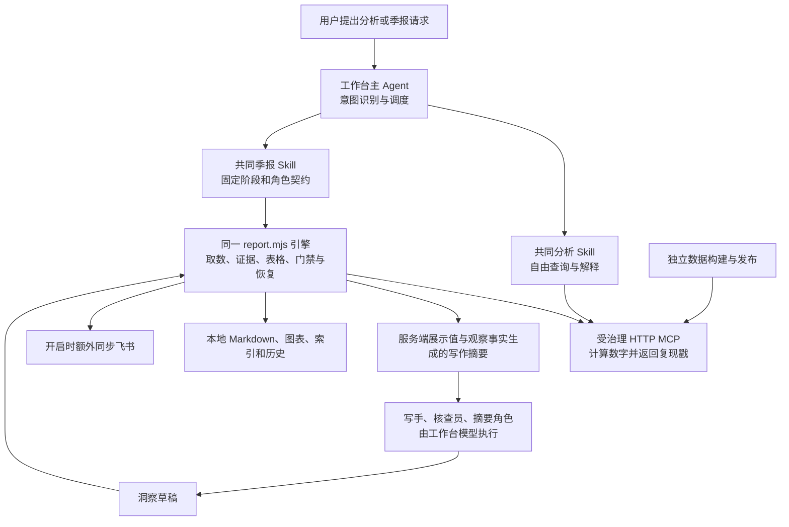

# Strategic Analytics 的共同核心

本文描述 **0.3.6 本地候选（未部署、未发行）**的共同组件与契约；本地政策激活、真实数据发布、生产代码和客户端发行是独立状态。正式公共包与生产 MCP 仍为 **0.3.5**，本轮不作现场读回、不升级正式宿主；生产执行、公开发行与正式宿主升级等待最终确认。

候选联动版本为插件/MCP **0.3.6**、pipeline **0.17.0** / table_spec **1.7.0** / scope **3.0.0** / currency_mapping **1.2.0** / band_policy **1.1.0**。mapping **2.1.0** 的 108 路径、7 个一级类目保持；有效一级下已登记的下级「其他」保留原桶并计入全市场与父级分母。用户已确认 MX/BR 四个价格、金额字段分别使用完整 MXN/BRL 单位及推送月完整交付，固定价格边界已批准，本次截止月沿用 **2026-09**。这些确认允许本地默认政策激活，不证明真实七组合数据已经构建或生产生效。

访问 URL、原令牌与纯 Bearer 认证不变，入口继续为 `/strategy/mcp`。以下为历史状态而非本轮新验收：0.3.5 已停用旧 `/flywheel/mcp`、不重定向，八个 OAuth/发现入口继续停用；108 项公网检查、14 工具合同及 24 查询对照见 [0.3.5 验收说明](ACCEPTANCE-0.3.5.md)。2026-10-20 的数据记录为 pipeline **0.16.1** / table_spec **1.6.0** / mapping 与 scope **2.0.0**、五组合、`direct_wide`、2024-01～2026-09，其构建和数据验收属于 [0.3.4](ACCEPTANCE-0.3.4.md)。不将历史时效、维护状态或测试成绩冒称本轮现场事实；[0.3.3](ACCEPTANCE-0.3.3.md) 与 [0.3.2](ACCEPTANCE-0.3.2.md) 亦只记录各自时点事实。共享 Dagster 布局、FX/行业调度和行业独立链不因扩围改变。

## 一份 package 的实际关系

插件是能力分发包。它不新建常驻分析 Agent，也不在安装后后台生成季报。用户请求触发宿主主 Agent，主 Agent 加载相应 Skill；后台数据构建属于独立服务。
共同标准落在 `SKILL.md + 包内 references/scripts/config + HTTP MCP + 显式输入输出`。
各平台的原生插件清单仍有格式差异，因此保留两份小型清单；方法论、角色、业务查询计划、校验和恢复算法只有一套。

## 仓库、安装包与远程服务

| 边界 | 实际文件 | 职责 |
| --- | --- | --- |
| 开发仓库 | methodology/、tests/、docs/，根 CLAUDE.md/AGENTS.md | 维护正本、生成投影、开发和验收；根指引不是分析工作区运行指南 |
| 安装包 | .claude-plugin/、.codex-plugin/、.mcp.json、skills/、codex/、agents/、workflows/、hooks/ | 分发共同 Skill、角色参考、可执行引擎与薄客户端接入 |
| 远程工具服务 | server/ | 标准只读 HTTP MCP，14 个工具；业务计算、复现戳、代次绑定与响应级警示由服务端承担。自 0.3.4 起仅保留 Bearer 接入（MCP OAuth 开发已停止），0.3.5 迁移至 `/strategy/mcp`；响应预算为 compact catalog 16 KiB、其余工具 64 KiB，超限返回小型明确错误；品牌窗口分页每页 512 行、最多 128 页、120 秒预算 |
| 远程数据构建 | pipeline/、dagster/ | 数据层语义、断言与发布；不进入客户端季报引擎。v1.7 本地候选沿用权威直供宽表，默认七组合/108 路径/六币种 48 档；来源、分类、历史、币种及 FX 均按绑定代次解释。旧 v1.6.0 pair 保持五组合/97 路径，不回写；构建按显式截止月冻结，本地默认不等于已部署数据 |

安装插件不会把远程服务部署到用户机器，也不授予直接访问 Doris 的能力。客户端脚本只调用受治理 MCP，不重算业务数字。

## 自由战略分析

宿主主 Agent 读取 `skills/strategic-analytics/SKILL.md`，按用户问题选择标准 MCP 工具，解释响应的展示值、状态与口径。
通用分析 Skill 是自由问答指导，不是另一个常驻 Agent，也不把所有问答塞进季报骨架。
分析文本以 `methodology/CORE.md` 为正本，季报规则以 `methodology/REPORT.md` 为正本。通用纪律按实际绑定代次解释范围与历史覆盖，不因包版本自动扩围；Skill、角色、工作区指引及 `server/src/instructions.generated.ts` 由同一构建生成，不另维护一份手写规则。本次元信息激活不为换版本机械改写正本。

### 分站点历史与比较

六国七组合是本地 v1.7 默认政策，不是所有历史 pair 的固定范围：原 Amazon US/USD、DE/EUR、JP/JPY、Taobao cn/CNY、Tmall cn/CNY 五组合从 2024-01 起；新增 Amazon MX/MXN、BR/BRL 从 2025-10 起。读侧从同一次因果判定返回的 release/build 读取该代站点合同、valid_from、版本/hash、FX 与固定价格政策；旧 pair 仍为五组合，请求其未纳入站点须拒绝。

当期早于任一请求站点起点时拒绝，不裁窗、不删站点。新七组合的全球 2026Q3 当期和对 2026Q2 的环比有源历史覆盖；对 2025Q3 的全球同比缺 MX/BR 基期，受影响的同比、份额变化、贡献与分解为 null，并披露具体缺口。原站点自身比较期完整时可保留合法同比，但不能替代七组合全市场基数；历史不足不当作零、entered 或业务增长。跨站点金额继续仅用 CNY，同代 FX 缺失必须失败关闭。

## 季报控制与写作

季报入口统一为 `skills/quarterly-report/SKILL.md`，正本是 `methodology/REPORT.md`。固定阶段依次为：
本宿主绑定核对与取数、可选图表、分章写作与语义核查、执行摘要最后写、组装/机械校验、可选同步、始终尝试本地收录。

| 组件 | 实际文件 | 承担的工作 |
| --- | --- | --- |
| 控制契约 | quarterly-report/SKILL.md | 固定阶段、输入/输出路径、有限修订与续跑、异常收尾；宿主按能力调度 |
| 非确定性角色 | references/writer.md、summary.md、verifier.md | 写章节、后写摘要、对照摘要核查；数字原样引用服务端 *_display，不计算、不生成表格 |
| 确定性引擎 | scripts/report.mjs、lib/plan.mjs、tables.mjs、artifacts.mjs、check.mjs、source-contract.mjs、report-scope.mjs、writing-observations.mjs | 固定查询计划、证据账本、骨架、摘要、表格、组装、机械门禁；source-contract 按绑定代次判定来源合同，report-scope 从同代冻结合同解析站点，writing-observations 生成 observations 投影与摘要数字白名单。默认重点仍为支撑类、灯光类、音视频类三章，全球分母覆盖全部受治理范围；每份写作摘要预算 32 KiB，超限失败关闭。旧默认配置保留，新 v1.7 配置仍是未部署候选，不代表本轮通过季报 Workflow 验收 |
| 身份、输入与发布绑定 | lib/run-binding.mjs、output-binding.mjs、input-view.mjs、check-binding.mjs、publish.mjs | 原运行身份、冻结输出、一次材料视图、正文/输入版本、发布计划与副本；变更后旧通过及旧链接不能归给新稿 |
| 收录与恢复 | lib/collect.mjs | 报告/图表、索引、历史、journal 与 EIO 恢复；保留原运行与用户文件 |
| 可选输出 | lib/charts.mjs、scripts/charts/、lib/publish.mjs | 锁定 Python 绘图与版面门禁；已登录 lark-cli 的个人空间同步 |

这里的 Workflow 是“固定控制流程 + 模型角色”，不是一个全确定性的 Agent。
`report.mjs` 的计划、服务端数字搬运、文件组装和机械校验是确定性部分；洞察选择、措辞与语义核查依赖模型，机械门禁也不能代替语义审阅。
没有协作能力时同会话按相同角色参考顺序完成，注明自查；有协作能力才委派实际独立角色，并报告未核查组。
没有增加 Agent runtime、服务器或客户端算术。

自由分析与季报角色的边界如下：

| 执行者 | 触发与输入 | 工具权限和产物 |
| --- | --- | --- |
| 宿主主 Agent：自由分析 | 用户临时问题 + 分析 Skill | 选择受治理 MCP，解释已有数字；可沿问题追查，不必生成季报 |
| 宿主主 Agent：季报控制者 | 季报意图 + 共同季报 Skill | 调用脚本、安排角色、有限修订和异常收尾，不自己重算业务数字 |
| report-runner 兼容 Agent | Claude 可选 Workflow 中的脚本阶段 | 执行同一引擎，保存证据；通用路径由主 Agent 直接做这项工作 |
| 章节写手 | 引擎产出的分章摘要、角色参考 | 写洞察文本，不调业务工具、不生成表格、不计算数字 |
| 语义核查员 | 相同摘要 + 写手草稿 | 审口径、来源和推断，返回问题；独立执行能力由宿主提供 |
| 摘要写手 | 先读对应 exec digest，再读已核查的章节成稿以把握重点 | 最后写执行摘要；数字只取对应 exec digest 的服务端展示值，不从正文抄取或重算 |

`agents/report-*.md` 是这些角色在 Claude 插件中的同源表示，不是四套业务引擎。其他宿主使用 references 的相同约束，不需要识别 Claude 的 Agent frontmatter 或模型别名。

## 小型接入与冻结

`scripts/codex.mjs` 保留严格路径：通过本地 `codex mcp get strategic --json` 白名单核对实际选择的 HTTP/bearer 声明，
`lib/codex-binding.mjs` 保存原 schema 的无明文凭据收据与本次输出。缺 CLI、绑定不符等情况失败关闭。

`scripts/setup.mjs` 复用 codex.mjs 的本地偏好实现，`lib/portable-binding.mjs` 只核对显式宿主数据路径和配对连接；
`portable-output.mjs` 可导入本宿主钩子的非敏感输出。它不读取客户端配置、不联网、不调用模型或飞书。
显式安全 connection.env 优先且不被环境覆盖；否则必须成对提供 STRATEGIC_MCP_URL/TOKEN，不猜默认地址或借用配置。
收据只保存端点、来源、凭据摘要、输出与完整性摘要，令牌只从原环境或原连接文件在进程内读取。

通用结果是 `paired_connection`、`host_mcp_config_verified=false`，只证明配对声明安全有效；Codex 结果才证明实际宿主配置被读取核对。
两者都不能代替实际工具认证与服务连通测试。摘要保证本地材料一致性，不是抵御同用户恶意进程重写全部记录的信任根。

prepare 显式消费 codex_binding 或 portable_binding。续跑核对原窗口/配置/收据身份以及原连接来源；
保留既有 status 的钉住代次合法性复查，其余已完成证据复用，只补缺失/失败调用。
Codex 与通用运行的 manifest 都保留与 run-args 相同的绑定标记；共享 run-binding 门禁在请求和输出前交叉核对，原身份缺失时拒绝降级为旧未绑定输出。
collect/publish（含直接 API）核对本次冻结 output_env，离线收录无需仍持有令牌。
两种绑定运行的同步都只使用冻结 lark-cli 路径；改变现行偏好只影响后续报告。
旧脚本 CLI、旧 Codex 收据和完整旧运行身份保留兼容；不能因为身份文件缺失就推断是旧未绑定运行，也不会把旧直接脚本运行冒称已验证。
导入钩子输出先捕获并验证，verify 只创建本次独立副本，不覆盖源 output.env。
旧绑定记录升级有先写恢复记录的有限协议：只接受准确的旧、待提交、已提交身份摘要与对应镜像；报告镜像原子写入，输出读取不改写原稿。
升级中断后仍可离线收录已有草稿或续跑，恢复记录偏离已知状态则失败关闭，不能把不一致视为普通旧记录。
升级记录以完整暂存文件原子创建且不覆盖现有目标，竞争写入者在 pending 身份写入前停止，避免不同升级 id 相互覆盖。同一运行的取数与写作仍由一名执行者完成。
升级摘要完成后作为不可变出处保留，迟到的已知 pending 版本仍可恢复；没有额外锁清理或凭据持久化。

## 三个客户端的入口

| 客户端 | 包入口 | 季报入口与差异 |
| --- | --- | --- |
| Codex | .codex-plugin/plugin.json 逐目录选择共同分析/季报 Skill 和 codex 下薄 setup | 严格 CLI/bearer；显式空 codex/hooks.json；同一 Skill 顺序执行或协作 |
| Claude Code | 既有 .claude-plugin、.mcp.json、skills/ 与 SessionStart hooks | userConfig 钩子交接 connection/output；Workflow 实际可用时为可选优化 |
| WorkBuddy | 官方兼容路径使用同一 .claude-plugin 包和共同 Skill；无插件入口时标准 MCP + 显式 Skill | 通用显式配对；不新增 manifest、不推断本项目 Workflow API；本轮按用户要求只交付引导 |

`codex/skills/quarterly-report/` 只保留同内容旧路径兼容投影，当前清单直接加载根目录共同文件；角色也来自同一 REPORT 正本。
`agents/report-*.md` 为 Claude 同源兼容投影，`workflows/quarterly-report.js` 保留原有限恢复、防重放与 finally 门禁。
CodeBuddy 是 setup 的小型接入别名，CLI 结果不能冒充 WorkBuddy GUI。

给分析工作区的运行指引为生成的 `methodology/dist/AGENTS.md` / `CLAUDE.md`，从 CORE 与 REPORT 共同生成。
宿主不自动加载时显式读取；不宣称小写单数 agent.md 在三个客户端自动生效。
手工接入必须保留完整 Skill 所在包的 references/scripts/config，脚本从实际已加载 Skill 文件定位，不猜安装缓存。

## 验收界限

0.3.4 发布阶段已完成真实开发库构建、独立验收、确认丢失恢复演练、金额库外复算及完整季报；生产首轮接线验证与新数据生产验收分开记录，具体结果见 [0.3.4 验收范围](ACCEPTANCE-0.3.4.md)。开发环境成功不证明生产数据已放行，代码版本也不能代替数据绑定状态。

Codex 实际安装、真人模型会话、原生宿主绑定、合成 HTTP 认证、真实服务查询、图表、故障注入和本地收录分别记录。0.3.4 的真实季报通过 unbound 兼容入口验证引擎与角色，不冒称新入口的原生宿主或 Workflow 实机验收；当时三项真实 Codex CLI 用例按名称排除，WorkBuddy 桌面实机及真实钥匙串不在当时通过范围。

本轮 0.3.6 仅推进本地候选激活和离线契约，真实七组合开发、Linux 接线、完整可部署制品及正式宿主升级均须另有实际证据；详细状态见 [0.3.6 候选验收范围](ACCEPTANCE-0.3.6.md)。临时配置下的原生清单安装与发现测试不等于正式宿主已升级，也不等于真实账号、钥匙串或桌面 GUI 通过。固定七个根契约中的合成 prepare/assemble/check/collect 不调用模型或 Workflow，不能冒称完整季报验收；本轮明确排除季报 Workflow、模型季报和额外报告测试，不新建或共享真实飞书业务文档。图表未生成、同会话自查、未核查组、同步关闭或失败仍须如实披露。
